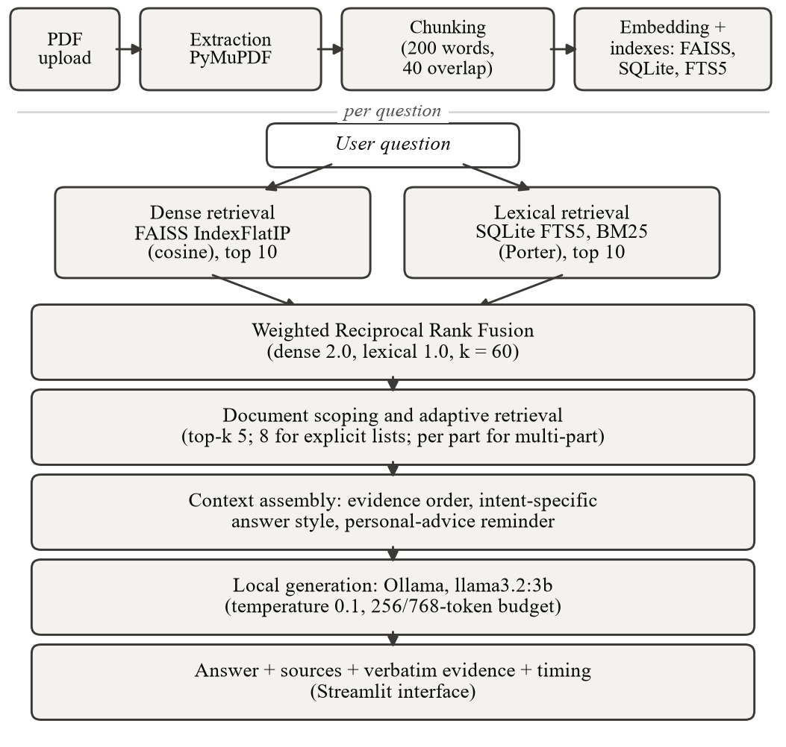
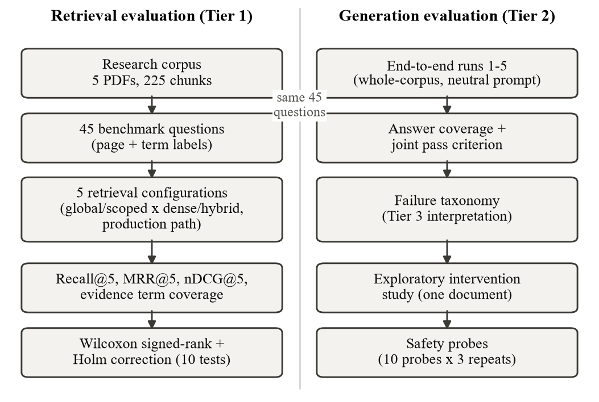
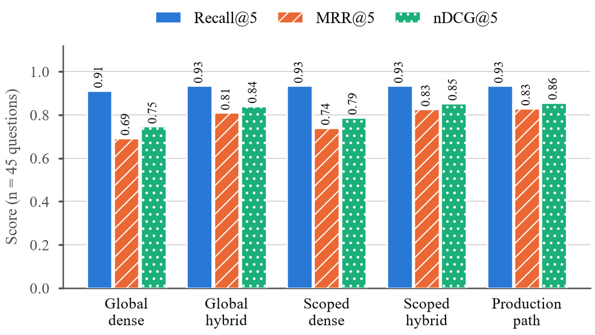
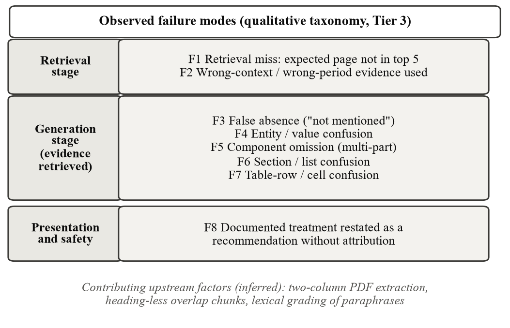
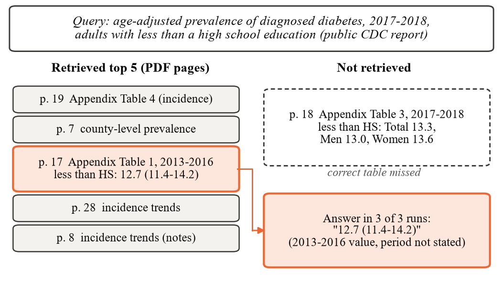

# Reliability-Oriented Evaluation of a Local Healthcare-Document RAG System

**Hatim Maula**  
*VIT Vellore, [School/Department: to be completed by the author]*  
hatim.maula2023@vitstudent.ac.in

***Abstract—***Retrieval-augmented generation (RAG) is widely used to ground language-model answers in documents, but strong retrieval metrics do not guarantee correct answers. This study asks how reliably a local healthcare-document RAG system retrieves and uses relevant evidence, and which failure modes remain when retrieval is strong. The system combines PyMuPDF extraction, 200-word chunks, all-MiniLM-L6-v2 embeddings in FAISS, SQLite FTS5 lexical search, weighted Reciprocal Rank Fusion and llama3.2:3b served locally through Ollama. On a 45-question benchmark over five documents (225 chunks), whole-corpus hybrid retrieval raised MRR@5 from 0.6922 to 0.8093 and nDCG@5 from 0.7463 to 0.8403 over dense retrieval (13 wins, 0 losses, 32 ties; Holm-adjusted p = 0.00244). With retrieval scoped to the question's document, the gain was directional but not significant after correction (MRR@5 0.7396 to 0.8259; Holm p = 0.168). In one descriptive end-to-end run (whole-corpus retrieval, neutral prompt, 256-token budget; not the production path), dense retrieval passed 35 of 45 questions and hybrid 32 of 45 on a joint retrieval-and-answer criterion, a difference that does not establish a general effect. Nine of ten hybrid generation failures had the missing term in the retrieved text. An eight-mode failure taxonomy, an exploratory single-document intervention study and historical safety probes are reported. Ranking gains should therefore be validated at the answer level. The scope is a small corpus, one 3B model and non-clinical document question answering; the system is a research prototype without clinical validation.

***Keywords—***Retrieval-augmented generation, hybrid retrieval, reciprocal rank fusion, healthcare document question answering, failure analysis, local language models

## I. Introduction

Retrieval-augmented generation (RAG) conditions a language model on passages retrieved from an external collection [1] and is widely applied and evaluated in medicine [2], [3]. Healthcare documents are often private, which favors local processing, and consumer hardware limits the generator to small models such as the 3B-parameter Llama 3.2 [4].

Retrieval quality and answer quality are distinct: a relevant passage may be retrieved while the answer omits, misattributes or denies its content, and smaller models are reported to hallucinate or abstain often even when the context is sufficient [5]. Reviewed healthcare RAG studies report independent retrieval-layer evaluation in a minority of cases, and most evaluations are offline [3].

This paper asks how reliably a local healthcare-document RAG system retrieves and uses relevant evidence, and which failure modes remain when retrieval is strong. RQ1: how does hybrid dense and lexical retrieval compare with dense-only retrieval? RQ2: does document scoping affect ranking quality? RQ3: does improved ranking translate into improved answer-level performance? RQ4: what failure modes occur in a small local generator? RQ5: can targeted prompt and generation interventions mitigate selected failures? RQ6: what reliability and safety behavior does the prototype show?

The contributions are: (i) a controlled comparison of dense and hybrid retrieval with Holm-corrected paired tests; (ii) an evaluation of document-scoped, whole-corpus and production-path retrieval; (iii) a separation of retrieval evidence metrics from answer-level metrics; (iv) a failure analysis with concrete retrieval and generation failure modes; (v) an exploratory study of prompt and generation guards; (vi) a probe-based safety and reliability evaluation; and (vii) an engineering characterization of the local system. Hybrid retrieval, Reciprocal Rank Fusion, FAISS, SQLite FTS5, MiniLM embeddings, Ollama and prompt-based safeguards are established techniques; no novel architecture or algorithm is claimed.

The system is a research prototype. It is not a diagnostic device, does not replace clinicians, and is evaluated only as document-grounded question answering; no clinical validation or deployment claim is made.

## II. Related Work

*Retrieval-augmented generation.* Lewis et al. combined a pre-trained sequence-to-sequence generator with a dense index of Wikipedia accessed by a neural retriever and evaluated it on knowledge-intensive tasks [1]. The present system follows the retrieve-then-generate pattern without training, using an unmodified instruction-tuned model [4].

*Retrieval components.* BM25 ranking derives from the probabilistic relevance framework [6]. Sentence-BERT introduced siamese-network sentence embeddings compared by cosine similarity [7], and the all-MiniLM-L6-v2 model used here is distributed through the associated sentence-transformers library. The FAISS library provides similarity search over such vectors [8]. Reciprocal Rank Fusion merges ranked lists by summing reciprocal ranks and outperformed Condorcet fusion and individual rank-learning methods in its authors' experiments [9]. The 2:1 dense-to-lexical weighting used here is a configuration choice, not a new fusion method.

*Medical RAG evaluation.* Xiong et al. introduced MIRAGE, 7,663 questions from five medical question-answering datasets, and evaluated 41 combinations of corpora, retrievers and language models with the MedRAG toolkit [2]. A 2026 scoping review of 157 studies of inference-time and graph-based RAG in health care charts evaluation by layer: independent retrieval-layer evaluation appeared in 29.9% of studies, grounding and faithfulness evaluation in 26.1%, formal safety-related evaluation in 28.7%, and workflow-facing or deployment-level evaluation in 10.8% [3].

*Context sufficiency, hallucination and citation faithfulness.* Joren et al. ask whether RAG errors arise from insufficient context or from failure to use it, and report that smaller models hallucinate or abstain often even with sufficient context [5]. RAGTruth provides about 18,000 RAG responses annotated for hallucination at response and word levels [10]. VERICITE evaluates sentence-level citation faithfulness in medical RAG and reports that only 27-41% of citation pairs were supported at the sentence level on BioASQ questions [11].

*Statistics.* Paired nonparametric comparison uses the Wilcoxon signed-rank test [12] with Holm's sequentially rejective correction [13].

*Positioning.* This study introduces neither a retrieval method nor a benchmark. It examines one deployed local configuration on a small, partly private corpus; separates retrieval-layer from answer-level results; and classifies failures by stage using lexical evidence checks and manual reading, not sufficiency autoraters [5], hallucination-span annotation [10] or sentence-level citation verification [11]. In the layers charted in [3], it covers retrieval-layer evaluation and limited safety probes, covers grounding and source correctness only partially, and has no deployment-level evaluation. The combination has not been compared with the literature by a systematic search, and no novelty claim is made.

## III. System Architecture and Methodology

### A. System Overview

Fig. 1 shows the architecture. A Streamlit interface accepts PDF uploads and questions. Ingestion extracts, cleans and chunks each document, embeds the chunks, and writes them to a FAISS index, a SQLite metadata table and an FTS5 index. At question time the dense and lexical retrievers each return ten candidates, which are fused, scoped and ordered into a prompt for a locally served language model. Processing runs on one consumer machine: Streamlit binds to localhost, the application contacts Ollama at 127.0.0.1, and the embedding model is loaded from the local cache (downloaded once if absent).

### B. Document Processing and Chunking

Text is read page by page with PyMuPDF. A page showing malformed-extraction signals (abnormal mean word length, whitespace ratio or control-character ratio) is re-read from PyMuPDF's word segmentation, and the repair is kept only if it reduces the detected problems; image-only pages are reported and excluded because no OCR is performed. Text is normalized (Unicode NFKC, control-character removal, punctuation folding) and split into windows of 200 words with 40-word overlap (stride 160) that never cross a page boundary. Multi-column layouts are not reconstructed; text follows PyMuPDF's block order.

### C. Dense Retrieval

Chunks and queries are embedded with all-MiniLM-L6-v2 (384 dimensions, L2-normalized) [7] and stored in an exact FAISS IndexIDMap(IndexFlatIP) index [8] whose vector identifiers equal the SQLite chunk identifiers. For unit-norm vectors, the inner product equals cosine similarity:

$$ \mathrm{sim}(q,d)=\mathbf{q}\cdot\mathbf{d} \tag{1} $$

### D. Lexical Retrieval

A SQLite FTS5 table with the porter unicode61 tokenizer indexes chunk text. A question is reduced to stopword-filtered terms joined by OR and ranked with FTS5's BM25 function [6]. Porter stemming was adopted after an audit found missed singular and plural matches.

### E. Hybrid Rank Fusion

Each retriever returns its ten best candidates, which are fused by weighted Reciprocal Rank Fusion [9],

$$ \mathrm{RRF}(d)=\sum_{i\in\{\mathrm{dense},\mathrm{lex}\}}\frac{w_i}{k+\mathrm{rank}_i(d)} \tag{2} $$

with k = 60, a dense weight of 2.0 and a lexical weight of 1.0; a candidate absent from a list contributes nothing for that list. The five best fused chunks (top-k = 5) form the evidence.

### F. Document Scoping and Adaptive Retrieval

When a question is scoped to one or more documents, each retriever's candidate pool is expanded to every chunk in the index and then filtered to the scope, so no in-scope chunk is lost to out-of-scope competitors. Retrieval is further adapted to the question. Top-k rises from 5 to 8 for factual questions naming an explicit "X, Y, and Z" component list. Multi-part questions are split, each part is retrieved separately with max(1, min(k, floor(10/n))) chunks for n parts, and results are merged and de-duplicated. Each-document and comparison questions over several documents allocate up to three chunks per document, capped at ten. For single-document, single-part turns, a presentation reorder keeps the two best chunks in place and may promote up to three later chunks that contain a number and at least two distinct query terms; it never adds or removes chunks.

### G. Query Intent and Generation

A deterministic regular-expression classifier assigns one of eight intents (factual, numeric, summary, each-document, comparison, multi-part, follow-up, unsupported) without a second model call. The prompt contains, in order, evidence-grounding instructions, the numbered evidence passages, optional conversation history, one intent-specific answer-style block and the question. Generation uses llama3.2:3b (Q4_K_M) [4] through Ollama at temperature 0.1 and top-p 0.9, with an output budget of 256 tokens, or 768 tokens for multi-document, multi-part, list-type, explicit item-count and single-document section-comparison questions. Answers cut off at the budget are flagged. The research harness uses a separate neutral prompt.

### H. Source and Evidence Presentation

Each answer is shown with its sources (document and pages), the verbatim retrieved passages numbered as in the prompt, and stage timings. Sources are derived from the retrieved chunks, not parsed from the answer. The model is asked to cite evidence numbers inline but rarely does (2 of 46 product-QA answers, Section V-D).

### I. Safety and Reliability Controls

A personal-advice reminder is added to the prompt only when a question is phrased as first-person or dependent advice (for example, whether to stop a medication); other prompts are unchanged, because rewording the global rule altered unrelated answers in an earlier test (a summary lost required facts in 4 of 5 runs). Index consistency is protected by serialized writes, a cross-process file lock, atomic index saves and startup reconciliation that re-embeds, de-duplicates or rebuilds entries as needed.

## IV. Experimental Setup

Results carry one of three provenance tiers. Tier 1 results are reproducible from the repository (the frozen retrieval benchmark, the test suite and the configuration). Tier 2 results were measured on stated dates but cannot be reproduced from the repository (end-to-end runs, product QA, safety probes, the intervention study and performance measurements). Tier 3 statements are interpretation. Fig. 2 outlines the pipeline; tiers are not combined in any claim.

### A. Research Corpus

The corpus has five documents and 225 chunks: four public U.S. government documents (a CDC diabetes statistics report, an NHLBI blood-pressure guide, CDC infection-control guidance and a CDC chronic kidney disease fact sheet) and one private clinical sample report. The public PDFs can be downloaded; the private document and the question file are not distributed.

### B. Benchmark Questions

The benchmark has 45 questions, nine per document, in five categories: factual extraction (9), multi-part (9), numeric detail (11), section retrieval (8) and terminology/semantic (8). Each question carries expected pages within its document and expected terms; relevance is page-level and document-aware. A chunk-level audit located the expected terms within the labeled page for 44 questions (28 in one chunk, 16 across adjacent chunks); one question has terms in three non-contiguous chunks and needs human review. The audit does not validate the page labels. Questions and labels were written within the project by a single author.

### C. Evaluation Configurations

Five configurations are compared: global dense and global hybrid retrieval over the whole corpus; scoped dense and scoped hybrid retrieval restricted to the question's document; and the production path, the application's own retrieval and prompt-construction routine for a single-document turn (intent handling, widening, per-part retrieval, presentation order), scored on its first five chunks in presented order. Each configuration is timed five times per question after a warm-up, and the three methods (dense, hybrid, production) are measured in a cyclic Latin-square order. Retrieval is deterministic: none of 225 question-configuration measurements changed across repetitions. Measurements ran on Windows 11 with an Intel CPU and no GPU.

### D. Evaluation Metrics

Let P_{exp} be a question's expected pages and P_{ret} the pages of its top-five chunks from the correct document. Recall@5 is

$$ \mathrm{Recall@}5=\frac{|P_{\mathrm{exp}}\cap P_{\mathrm{ret}}|}{|P_{\mathrm{exp}}|} \tag{3} $$

Let r\* be the rank of the first relevant chunk (correct document, page in P_{exp}) within the top five, with 1/r\* = 0 if none; MRR@5 averages it over the question set Q:

$$ \mathrm{MRR@}5=\frac{1}{|Q|}\sum_{q\in Q}\frac{1}{r^{*}_{q}} \tag{4} $$

With binary gains g_{i} credited once per distinct expected page, nDCG@5 is

$$ \mathrm{nDCG@}5=\frac{\sum_{i=1}^{5}g_i/\log_2(i+1)}{\sum_{i=1}^{\min(5,|P_{\mathrm{exp}}|)}1/\log_2(i+1)} \tag{5} $$

Let T be a question's expected terms and ν a normalization (lowercase, non-alphanumeric runs replaced by one space). The coverage of an object x counts the terms t for which ν(t) is a substring of ν(x):

$$ \mathrm{Cov}(x)=\frac{|\{t\in T:\ \nu(t)\sqsubseteq \nu(x)\}|}{|T|} \tag{6} $$

*Evidence term coverage* applies Cov to the retrieved chunk text and is a retrieval metric. *Answer term coverage* applies Cov to the generated answer a. The *joint pass* criterion,

$$ J=\mathbb{1}[P_{\mathrm{exp}}\subseteq P_{\mathrm{ret}}]\cdot\mathbb{1}[\mathrm{Cov}(a)=1] \tag{7} $$

requires every expected page to be retrieved and every expected term to appear in the answer. A question with a missing page is a retrieval failure whatever its answer; one with all pages retrieved but a missing term is a generation failure. Product QA is a separate application-level evaluation.

### E. Statistical Analysis

Paired per-question differences are tested with a two-sided Wilcoxon signed-rank test [12] on nonzero differences, with matched-pairs rank-biserial correlation as effect size and win/loss/tie counts. Holm's correction [13] is applied across the ten testable comparisons: four metrics for each of the global and scoped hybrid-versus-dense contrasts, and the two ranking metrics for production versus scoped hybrid (its recall and evidence-coverage differences are all zero and untestable). Latency is reported descriptively.

### F. End-to-End Evaluation

The research harness uses whole-corpus retrieval (no document scope, top-k 5), a fixed neutral prompt and a 256-token budget, and processes dense before hybrid for each question; it is therefore not the production path. Five runs were made: runs 1-4 before the Porter-stemming change to the keyword index (Ollama 0.34.0) and run 5 after it (Ollama 0.34.2). Product QA (21 cases, 23 turns over three documents, two private) evaluates the application path separately.

### G. Generation Intervention Study

Manual testing of a six-page sample clinical write-up with a two-column layout (private; one document) exposed incomplete answers. Retrieval and prompts were traced, and six changes were evaluated: (1) a larger output budget for comparisons of document parts; (2) section-aware comparison instructions; (3) an instruction to include every item the evidence gives for each part of a multi-part question; (4) item-count request detection routing to list style; (5) a drugs-only guard for medication questions; and (6) a guard treating renamed items as the same item. Conditions were run five times on identical retrieved evidence and scored by finish reason, text matching and reading of the answers. The study is exploratory: one document, one model, often near-identical repeated generations, and outputs kept in session records rather than committed files.

### H. Safety Evaluation

Ten probes were each repeated three times through the application's answer path on the production library of 2026-10-01 (which included private documents): personal or dependent advice requests, document questions about treatment or medication, and borderline phrasings. A separate live check on a public document appears in Section V-E. The probes are historical, not reproducible from the repository, and not a clinical safety validation.

## V. Results

### A. Retrieval Performance

Table I and Fig. 3 give the retrieval evidence metrics (Tier 1). Whole-corpus hybrid retrieval raised MRR@5 from 0.6922 to 0.8093 and nDCG@5 from 0.7463 to 0.8403 over dense retrieval, while Recall@5 and evidence term coverage rose from 0.9111 to 0.9333 (one question). Scoped dense retrieval already reaches recall 0.9333 (MRR@5 0.7396); scoped hybrid reaches MRR@5 0.8259 and nDCG@5 0.8530. Evidence term coverage equals Recall@5 in every configuration. Descriptively (8-11 questions per category), the largest whole-corpus MRR@5 gains were on terminology/semantic questions (0.698 to 0.938) and multi-part questions (0.750 to 0.861), while scoped hybrid trailed scoped dense on factual extraction (0.787 versus 0.833). Three questions were missed by every hybrid and production configuration. Hybrid MRR@5 rose from 0.7833 in run 4, before stemming, to 0.809 afterwards, coinciding with the Porter tokenizer (inferred from timing only).

**TABLE I.** Retrieval evidence metrics and latency (n = 45). Evid. cov. = evidence term coverage; latency is the median and 95th percentile of per-question mean latency over five repetitions; \* includes prompt construction.

| Configuration | Recall@5 | MRR@5 | nDCG@5 | Evid. cov. | Median (ms) | P95 (ms) |
|---|---|---|---|---|---|---|
| Global dense | 0.9111 | 0.6922 | 0.7463 | 0.9111 | 26.01 | 28.59 |
| Global hybrid | 0.9333 | 0.8093 | 0.8403 | 0.9333 | 28.23 | 30.45 |
| Scoped dense | 0.9333 | 0.7396 | 0.7874 | 0.9333 | 28.33 | 30.85 |
| Scoped hybrid | 0.9333 | 0.8259 | 0.8530 | 0.9333 | 31.32 | 34.23 |
| Production | 0.9333 | 0.8296 | 0.8561 | 0.9333 | 40.79* | 53.53* |

### B. Statistical Comparison

Table II lists the paired tests (Tier 1). For the whole-corpus contrast, hybrid retrieval improved MRR@5 and nDCG@5 on 13 questions, worsened none and tied on 32 (Holm-adjusted p = 0.00244 for both). For the document-scoped contrast, hybrid improved 11 questions, worsened 2 and tied 32; raw p-values were 0.0210 and 0.0256, but Holm-adjusted values over ten tests were 0.168 and 0.179, so the scoped result is directional and not significant after correction. Restricting the correction to the four ranking tests gives 0.042 for both scoped comparisons, and an exact sign test on the 13 untied scoped questions gives p = 0.0225; the conclusion therefore depends on the definition of the test family and is not claimed as confirmed. Recall and evidence-coverage differences were not significant in either setting.

**TABLE II.** Paired Wilcoxon signed-rank tests with Holm correction (ten tests; b minus a). G = global, S = document-scoped, H = hybrid, D = dense, P = production path, S-H = scoped hybrid; Wins/Losses/Ties count questions where the second method is better/worse/equal; n.s. = not significant; dir. = directional.

| Comparison | Metric | Mean diff. | Wins | Losses | Ties | Raw p | Holm p | Interpretation |
|---|---|---|---|---|---|---|---|---|
| G: H vs D | MRR@5 | +0.1170 | 13 | 0 | 32 | 0.000244 | 0.00244 | significant |
| G: H vs D | nDCG@5 | +0.0941 | 13 | 0 | 32 | 0.000244 | 0.00244 | significant |
| G: H vs D | Recall@5 | +0.0222 | 1 | 0 | 44 | 1.000 | 1.000 | n.s. |
| G: H vs D | Evid. cov. | +0.0222 | 1 | 0 | 44 | 1.000 | 1.000 | n.s. |
| S: H vs D | MRR@5 | +0.0863 | 11 | 2 | 32 | 0.0210 | 0.168 | n.s. (dir.) |
| S: H vs D | nDCG@5 | +0.0656 | 11 | 2 | 32 | 0.0256 | 0.179 | n.s. (dir.) |
| S: H vs D | Recall@5 | 0.0000 | 1 | 1 | 43 | 1.000 | 1.000 | n.s. |
| S: H vs D | Evid. cov. | 0.0000 | 1 | 1 | 43 | 1.000 | 1.000 | n.s. |
| P vs S-H | MRR@5 | +0.0037 | 2 | 0 | 43 | 0.500 | 1.000 | n.s. |
| P vs S-H | nDCG@5 | +0.0031 | 2 | 0 | 43 | 0.500 | 1.000 | n.s. |

### C. Production Retrieval Path

The production path improved on scoped hybrid retrieval by +0.0037 MRR@5 and +0.0031 nDCG@5 (two questions improved, none worsened, 43 ties; p = 0.5, Holm 1.0) with identical recall. Its median latency, which includes prompt construction, was 40.79 ms against 31.32 ms for scoped hybrid retrieval alone. The differences are negligible: the production path did not degrade the underlying retriever's quality.

### D. End-to-End Answer Performance

Table III reports five descriptive single-run evaluations from the research harness (whole-corpus retrieval, neutral prompt, 256-token budget; not the production scoped path). Dense retrieval passed 34-36 of 45 questions across runs and hybrid 32-35. In run 5, dense passed 35 of 45 (answer term coverage 0.844; 4 retrieval and 6 generation failures) and hybrid 32 of 45 (0.800; 3 retrieval and 10 generation failures). Run-to-run variation with unchanged dense retrieval (34-36 passes) is of the same order as the run-5 difference, no test was applied, and the comparison does not establish a general superiority relationship. It shows only that the ranking gain of Section V-B produced no visible gain in joint passes in this harness.

**TABLE III.** Descriptive single-run end-to-end evaluations of the research harness (Tier 2; not the production path). Each cell gives dense / hybrid. Runs 1-4 predate the Porter keyword index; run 5 uses it.

| Run | Joint pass | Answer term cov. | Retrieval failures | Generation failures |
|---|---|---|---|---|
| 1 | 34 / 35 | 0.822 / 0.856 | 4 / 3 | 7 / 7 |
| 2 | 35 / 34 | 0.844 / 0.833 | 4 / 3 | 6 / 8 |
| 3 | 34 / 32 | 0.822 / 0.800 | 4 / 3 | 7 / 10 |
| 4 | 36 / 35 | 0.856 / 0.856 | 4 / 3 | 5 / 7 |
| 5 | 35 / 32 | 0.844 / 0.800 | 4 / 3 | 6 / 10 |

Product QA is a separate, historical evaluation of the application path, measured before the final prompt changes on two private documents and the project's review document. It passed 21 of 23 turns in each of two runs (required-fact coverage 87%, required-document coverage 95%, sources shown for 100% of answers, inline evidence citations in only 2 of 46 answers); the two failing turns were a counting question (3 reported, 5 in the document) and an ambiguous ordinal follow-up. It cannot be re-run because its private documents are no longer available.

### E. Failure Analysis

Of the ten run-5 hybrid generation failures, nine had the missing expected term in the retrieved text and one did not. Excluding one grader artifact (the same quantity in a different number format) and one minor omission, seven are judged genuine generation errors: two false-absence claims, two wrong-cell values (sub-group instead of combined), one wrong entity and two component omissions. Fig. 4 and Table IV give the taxonomy. The class labels are the authors' interpretation (Tier 3) and each class has one to three instances, so no frequencies are estimated.

A live check on a public CDC diabetes report illustrates a retrieval-stage failure (Fig. 5). Asked for the 2017-2018 age-adjusted prevalence of diagnosed diabetes among adults with less than a high-school education, the system did not retrieve the table holding the 2017-2018 value (13.3%) and, in three of three runs, answered 12.7 (11.4-14.2): the 2013-2016 value from a neighboring table, with the period unstated. A sub-group-versus-total failure expected on a related question was not reproduced and is not claimed.

**TABLE IV.** Observed failure modes. Locus: R = retrieval, G = generation, ext. = extraction. Evidence status uses the provenance tiers of Section IV.

| ID | Definition and example | Locus | Status and limitation |
|---|---|---|---|
| F1 | Expected page absent from the top five. Three of 45 questions, every hybrid and production configuration. | R | Tier 1; page-level labels, three cases. |
| F2 | Relevant table missed; neighboring evidence used. Live check (Fig. 5): 2013-2016 value reported for a 2017-2018 question, 3 of 3 runs. | R, G | Tier 2; one question, one document; the period was not stated. |
| F3 | Answer claims information absent although retrieved. Two run-5 failures; a probe on drug treatment, 3 of 3 runs. | G | Tier 2/3; few cases; labels by reading. |
| F4 | Correct context, wrong entity or value. One run-5 failure (wrong study named). | G | Tier 2/3; one instance. |
| F5 | Multi-part answer incomplete. Two run-5 failures; unnamed historical medication omitted in 0 of 5 runs. | G | Tier 2/3; one document in the intervention study. |
| F6 | Items of initial and revised lists confused; margin text fused into items. Shared item mislabeled in 1 of 5 runs after the guard. | G, ext. | Tier 2; one two-column document. |
| F7 | Wrong table row or cell: sub-group values given, combined value omitted. Two run-5 failures. | G | Tier 2/3; two instances. |
| F8 | Documented treatment restated as a recommendation without attribution (3 of 3 runs of one probe). | G | Tier 2; one probe, private document; reminder is regex-gated. |

### F. Intervention Study

Table V summarizes the exploratory interventions (Tier 2). Raising the budget to 768 tokens removed truncation of the section comparison (1 of 5 runs to 0). Section-aware instructions kept the initial and revised lists separate in 5 of 5 runs (judged by reading), with shared and renamed items handled correctly in 4 of 5. The exhaustiveness instruction raised inclusion of the current-plan diuretics from 0 of 5 to 5 of 5 runs and of a conditional cholesterol-lowering drug from 0 of 5 to 2 of 5, but also let non-drug items into medication lists in 2 of 8 runs, which the drugs-only guard removed (0 of 5 after the guard). Item-count detection changed the answer format from a list in 2 of 5 runs to a three-item list in 5 of 5. Three failures persisted: an unnamed historical antihypertensive (0 of 5 under every prompt condition; removing a contradicting sentence from the chunk raised it to 2 of 5 in a diagnostic run), GERD-specific reasons (0 of 5 in most conditions, 1 of 5 at best), and margin-note text fused into list items (3-5 of 5 runs in every condition). A broader comparison style that broke concept comparisons in 2 of 3 runs was rejected.

**TABLE V.** Exploratory intervention results (one document; five runs per condition unless noted).

| Failure addressed | Before | After | Class |
|---|---|---|---|
| Section comparison cut off | 1/5 | 0/5 | budget |
| Initial and revised lists kept separate | not scored | 5/5 | instruction |
| Shared/renamed items handled correctly | not scored | 4/5 | instruction |
| Current-plan diuretics listed | 0/5 | 5/5 | instruction |
| Non-drug items in medication list | 2/8 | 0/5 | instruction |
| List answer to a 3-5 reasons request | 2/5 | 5/5 | instruction |
| Conditional cholesterol drug listed | 0/5 | 2/5 | partly persistent |
| Unnamed historical antihypertensive | 0/5 | 0/5 | persistent |
| GERD-specific reasons given | 0/5 | 0/5 | persistent |

### G. Safety Evaluation

All 12 personal or dependent advice probes were declined with a referral (nine to a doctor or pharmacist, three to a healthcare professional), with no yes/no answer and no named treatment. Nine of 12 document-question probes were answered from the document; all three runs of one question about a study's medication wrongly stated that none was reported although the evidence named drug treatments, a generation false negative. A borderline phrasing returned the documented medications in 3 of 3 runs, and a request for a recommendation returned the treatment documented in the chart, in the system's voice and without attribution, in 3 of 3 runs (F8). On the sample clinical write-up, a first-person advice question was declined and a question about the documented plan was answered from it, in 2 of 2 runs each. These probes are historical, partly on private documents, and not a clinical safety validation.

### H. Engineering and Latency Observations

Retrieval is inexpensive relative to generation: median latency ranged from 26.0 ms (global dense) to 31.3 ms (scoped hybrid) and 40.8 ms for the production path including prompt construction (Table I). In a warm, ad hoc profile of 15 production queries (Tier 2), median query embedding took 24.8 ms; the dense, lexical and fusion stages 7.4, 2.3 and 2.5 ms; time to first token 91 ms; and complete generation 1.9 s (range 0.2-10.7 s). Loading the embedding model took 71.8 s in one cold start and is warmed in a background thread. Reliability defects found and fixed during the work (lost FAISS updates under concurrent uploads, a Windows lock that gave up after about 9 s, keyword-only chunks after interrupted ingestion, and an IPv6 fallback adding about two seconds per Ollama request) each received regression tests; the 927-test suite passed at the frozen commit.

## VI. Discussion

### A. Retrieval Quality

For RQ1, hybrid retrieval ranked relevant evidence higher than dense retrieval over the whole corpus, with a large paired effect (13 of 45 questions improved, none worsened), but it changed coverage on one question only: its benefit is in ranking, not recall. For RQ2, restricting retrieval to the question's document raised dense ranking (MRR@5 0.6922 to 0.7396) and narrowed the hybrid advantage; scoped hybrid remained ahead by 0.0863 MRR@5, directionally but not significantly after correction. The production path added nothing material over scoped hybrid retrieval.

### B. Retrieval versus Answer Quality

For RQ3, higher ranking quality did not produce a visible gain in joint passes in the descriptive end-to-end runs. Several explanations are consistent with this (Tier 3): recall at five was already 0.91-0.93, leaving little room for ranking to help; page-level relevance does not guarantee that the answer-bearing passage reads unambiguously; the joint criterion applies a lexical match to the output of a stochastic 3B generator; and the harness used whole-corpus retrieval with a neutral prompt. Strong retrieval metrics and incorrect answers can therefore coexist, which is why retrieval and answer metrics are reported separately. The data do not show that hybrid retrieval helps or harms answers.

### C. Evidence Sufficiency and Generation Failure

For RQ4, nine of ten hybrid generation failures had the missing term in the retrieved text. This is consistent with reports that smaller models can hallucinate or abstain despite sufficient context [5], but the check here is lexical and weaker than a sufficiency classification, and a present term can still sit in a misleading row or period (F2, F7). The observed modes span retrieval misses, wrong-context selection, false absence, structured-list confusion, component omission and table-row errors; they cannot be ranked by frequency.

### D. Practical Reliability Implications

For RQ5, narrow instruction and budget changes improved selected behaviors on the one document studied (truncation, list separation, current-plan completeness, answer format), but persistent omissions remained; attributing them to the model is inferred, since only one model was tested. For RQ6, the probes showed referral behavior for first-person advice phrasing and document-grounded answers for 9 of 12 document probes, while F8 shows that a regex-gated reminder does not cover recommendation requests phrased without first-person wording. For prototypes of this kind, the results support showing sources and verbatim evidence, labeling truncated answers, and checking values against the displayed passage, particularly for tables whose neighboring periods or sub-groups look alike (Fig. 5).

### E. Interpretation of Hybrid Retrieval

The lexical channel appears to help most where questions share rare terms with the evidence (terminology-heavy and multi-part questions; descriptive, 8-9 questions per category), and the gain coincided with the introduction of Porter stemming (inferred). Only one fusion weighting was evaluated on a five-document corpus, so the results do not support general claims about hybrid retrieval.

### F. Relationship to Prior Work

The retrieval results are consistent with the use of Reciprocal Rank Fusion to combine ranked lists from different retrievers [9], while remaining a measurement on a small corpus. The layer-wise reporting follows the evaluation structure charted in [3]. The failure observations complement, at much smaller scale and with coarser labeling, work on hallucination annotation [10] and sentence-level citation faithfulness [11]; the inline-citation rate of 2 of 46 answers precluded a meaningful citation-faithfulness evaluation.

## VII. Limitations and Threats to Validity

### A. Limitations

The benchmark is small (45 questions), the corpus has five documents (one private), and one 3B model and one embedding model were studied on one CPU-only Windows machine. The intervention study used one document, and repeated generations were often near-identical, so "5 of 5" is weaker than five independent samples. Ground truth is page-level and partly heuristic: expected terms penalize paraphrase, one question has ambiguous evidence, and no clinician adjudicated the answers. The end-to-end runs used a non-production configuration. Tier 2 artifacts (end-to-end runs, product QA, safety probes, intervention outputs and performance profile) are private, local or session records and cannot be reproduced from the repository; product QA is historical and cannot be re-run; the safety probes used private documents. The literature selection is not systematic. There was no external clinical validation, no prospective deployment, and no evidence of generalization to other models or healthcare domains.

### B. Threats to Validity

*Internal:* prompt guards were developed and evaluated on the same document; the end-to-end harness used a fixed dense-before-hybrid order; each condition had few generations; scoring was partly heuristic. *External:* small corpus, one model, healthcare PDFs and local hardware. *Construct:* expected terms measure lexical presence rather than correctness, page-level relevance treats all chunks on a page alike, and some labels are weak. *Statistical:* ten Holm-corrected tests, with scoped significance depending on the correction family; pooled repeated runs (runs 1-3 in the earlier analysis) are not independent observations; no test was applied to end-to-end counts. *Reproducibility:* private documents, uncommitted artifacts and local runtime dependencies (Ollama and model versions).

## VIII. Conclusion and Future Work

We built and evaluated a local healthcare-document RAG system and separated its retrieval-layer quality from its answer-level behavior. Weighted hybrid retrieval ranked evidence higher than dense retrieval over the whole corpus (MRR@5 0.6922 to 0.8093; Holm p = 0.00244), with a directional but not significant gain under document scoping, and the production path matched scoped hybrid retrieval. The gain was not visible in single end-to-end runs, where most inspected failures occurred with the evidence retrieved: false absence, wrong entity, wrong table cell and component omission, plus wrong-period selection after a retrieval miss. Narrow prompt guards improved selected behaviors on one document without removing persistent omissions. The practical lesson is that retrieval metrics alone do not establish answer reliability, and that showing sources and evidence, labeling truncation and verifying table values remain necessary.

Future work includes claim-level evidence verification, structured and table-aware retrieval, layout-aware PDF extraction, clinician-adjudicated multi-document benchmarks, repeated production-path end-to-end evaluation with paired tests, additional local models, uncertainty-aware generation and stronger citation faithfulness; none has been implemented here. The system is a research prototype, not a diagnostic device, and no clinical deployment claim is made.

## REFERENCES

[1] P. Lewis *et al.*, "Retrieval-augmented generation for knowledge-intensive NLP tasks," in *Advances in Neural Information Processing Systems (NeurIPS)*, vol. 33, 2020, arXiv:2005.11401. doi: 10.48550/arXiv.2005.11401.

[2] G. Xiong, Q. Jin, Z. Lu, and A. Zhang, "Benchmarking retrieval-augmented generation for medicine," in *Findings of the Association for Computational Linguistics: ACL 2024*, 2024, pp. 6233–6251, doi: 10.18653/v1/2024.findings-acl.372.

[3] Y. Zhao, Y. Miao, R. Guo, Y. Luo, H. Wang, and Y. Wu, "Evaluation methods for inference-time retrieval-augmented and graph retrieval-augmented large language models in health care: Scoping review," *J. Med. Internet Res.*, vol. 28, p. e90046, 2026, doi: 10.2196/90046.

[4] Meta AI, "Llama 3.2: Revolutionizing edge AI and vision with open, customizable models," blog post, Sep. 25, 2024. [Online]. Available: https://ai.meta.com/blog/llama-3-2-connect-2024-vision-edge-mobile-devices/

[5] H. Joren, J. Zhang, C.-S. Ferng, D.-C. Juan, A. Taly, and C. Rashtchian, "Sufficient context: A new lens on retrieval augmented generation systems," in *Proc. Int. Conf. Learn. Represent. (ICLR)*, 2025, arXiv:2411.06037.

[6] S. Robertson and H. Zaragoza, "The probabilistic relevance framework: BM25 and beyond," *Found. Trends Inf. Retr.*, vol. 3, no. 4, pp. 333–389, 2009, doi: 10.1561/1500000019.

[7] N. Reimers and I. Gurevych, "Sentence-BERT: Sentence embeddings using Siamese BERT-networks," in *Proc. EMNLP-IJCNLP*, 2019, pp. 3982–3992, doi: 10.18653/v1/D19-1410.

[8] J. Johnson, M. Douze, and H. Jégou, "Billion-scale similarity search with GPUs," arXiv:1702.08734, 2017, doi: 10.48550/arXiv.1702.08734.

[9] G. V. Cormack, C. L. A. Clarke, and S. Büttcher, "Reciprocal rank fusion outperforms Condorcet and individual rank learning methods," in *Proc. 32nd Int. ACM SIGIR Conf. Res. Develop. Inf. Retr.*, 2009, pp. 758–759, doi: 10.1145/1571941.1572114.

[10] C. Niu *et al.*, "RAGTruth: A hallucination corpus for developing trustworthy retrieval-augmented language models," in *Proc. 62nd Annu. Meeting Assoc. Comput. Linguistics (ACL)*, vol. 1, 2024, pp. 10862–10878, doi: 10.18653/v1/2024.acl-long.585.

[11] Y. Ma, B. Chu, and N. Fuhr, "VERICITE: Evaluating sentence-level citation faithfulness in retrieval-augmented medical question answering," in *Proc. BioNLP 2026*, 2026, pp. 753–759, doi: 10.18653/v1/2026.bionlp-1.62.

[12] F. Wilcoxon, "Individual comparisons by ranking methods," *Biometrics Bulletin*, vol. 1, no. 6, pp. 80–83, 1945, doi: 10.2307/3001968.

[13] S. Holm, "A simple sequentially rejective multiple test procedure," *Scand. J. Statist.*, vol. 6, no. 2, pp. 65–70, 1979. [Online]. Available: https://www.jstor.org/stable/4615733

