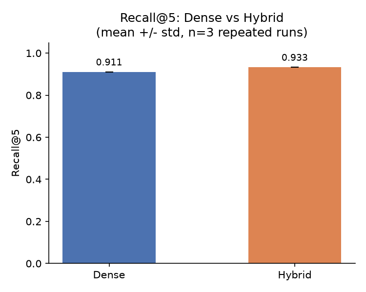
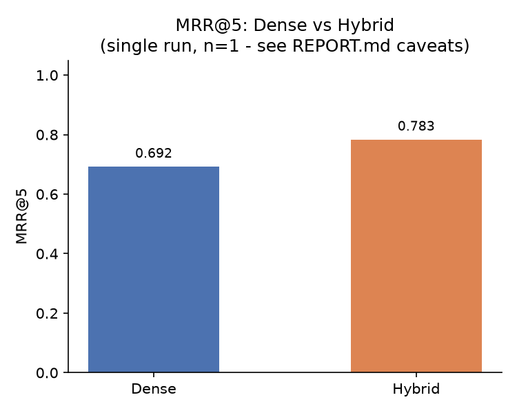
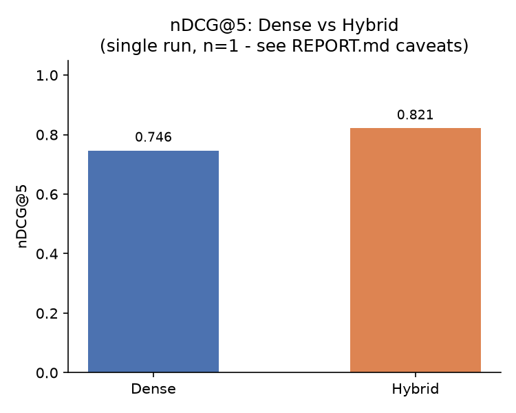
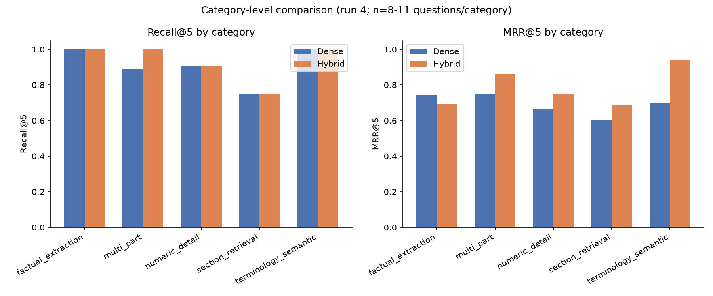

# RAG for Healthcare Documents - Research Results Report

*Generated entirely by `research/generate_report.py` from already-persisted evaluation result files - no retrieval, generation, or Ollama call was made to produce this report. Every number below is either read verbatim from an existing result file or computed by a plain mean/groupby over already-computed per-question values in one of those files. See "Reproducibility" for exact sources.*

## 1. Experimental Setup

- **Corpus:** `data/research_corpus/` - 5 healthcare documents, 45 questions total, 225 chunks (per `data/evaluation_corpus.json`)
- **Document count:** 5 (4 downloaded public-domain U.S. government documents + 1 user-provided clinical report)
- **Question count:** 45 (`data/healthcare_eval_questions.json`), ~9 per document, balanced across 5 question-type categories
- **Dense method:** FAISS exact search (`IndexFlatIP`) over MiniLM embeddings
- **Hybrid method:** FAISS + SQLite FTS5, weighted Reciprocal Rank Fusion (dense weight=2.0, keyword weight=1.0, rrf_k=60, candidate_k=10)
- **Embedding model:** `sentence-transformers/all-MiniLM-L6-v2` (384-dim)
- **Top-k:** 5
- **Ollama model:** `llama3.2:3b` (temperature=0.1, top_p=0.9, num_predict=256)
- **Ollama version (recorded):** 0.34.0
- **Repeated runs:** 4 total publication runs exist (`publication_run1`-`4`). Runs 1-3 measured Recall@5/Term Coverage/latency only (predate MRR@5/nDCG@5). Run 4 is the only run measuring all seven metrics. See "Statistical Analysis" for exactly what is and isn't repeated-run data.

## 2. Overall Results

| Metric | Dense | Hybrid | Abs. Diff (Hybrid-Dense) | Basis |
|---|---|---|---|---|
| Recall@5 | 0.911 +/- 0.000 | 0.933 +/- 0.000 | 0.022 | n=3 runs |
| MRR@5 | 0.692 (n=1) | 0.783 (n=1) | 0.091 | n=1 run |
| nDCG@5 | 0.746 (n=1) | 0.821 (n=1) | 0.075 | n=1 run |
| Term Coverage | 0.830 +/- 0.013 | 0.830 +/- 0.028 | 0.000 | n=3 runs |
| Retrieval latency (ms) | 41.188 +/- 1.486 | 44.753 +/- 1.829 | 3.566 | n=3 runs |
| Generation latency (ms) | 28321.966 +/- 239.789 | 23674.815 +/- 285.090 | -4647.152 | n=3 runs |
| End-to-end latency (ms) | 28363.154 +/- 241.275 | 23719.568 +/- 286.493 | -4643.586 | n=3 runs |

**Do not treat Runs 1-3 as containing MRR@5/nDCG@5** - they predate those metrics. MRR@5 and nDCG@5 above come exclusively from run 4 (n=1, no std).

## 3. Retrieval Ranking Analysis

| Metric | Dense | Hybrid | Absolute Difference |
|---|---|---|---|
| Recall@5 | 0.911 | 0.933 | 0.022 |
| MRR@5 | 0.692 | 0.783 | 0.091 |
| nDCG@5 | 0.746 | 0.821 | 0.075 |

Per-question winner counts (of 45; "tie" = identical score): MRR@5 - hybrid 14, dense 1, tie 30. nDCG@5 - hybrid 14, dense 1, tie 30.
Dense outranked hybrid on MRR@5 for: H42.







## 4. Category Analysis

(Source: run 4 only - see report_lib.py docstring)

| Category | Method | N | Recall@5 | MRR@5 | nDCG@5 | Term Coverage |
|---|---|---|---|---|---|---|
| factual_extraction | dense | 9 | 1.000 | 0.744 | 0.805 | 0.722 |
| factual_extraction | hybrid | 9 | 1.000 | 0.694 | 0.770 | 0.833 |
| multi_part | dense | 9 | 0.889 | 0.750 | 0.785 | 0.833 |
| multi_part | hybrid | 9 | 1.000 | 0.861 | 0.896 | 0.944 |
| numeric_detail | dense | 11 | 0.909 | 0.662 | 0.723 | 0.864 |
| numeric_detail | hybrid | 11 | 0.909 | 0.750 | 0.790 | 0.818 |
| section_retrieval | dense | 8 | 0.750 | 0.604 | 0.641 | 0.875 |
| section_retrieval | hybrid | 8 | 0.750 | 0.688 | 0.704 | 0.688 |
| terminology_semantic | dense | 8 | 1.000 | 0.698 | 0.774 | 1.000 |
| terminology_semantic | hybrid | 8 | 1.000 | 0.938 | 0.954 | 1.000 |



## 5. Document Analysis

(Source: run 4 only)

| Document | Method | N | Recall@5 | MRR@5 | nDCG@5 | Term Coverage |
|---|---|---|---|---|---|---|
| CDC's Core Infection Prevention and Control Practices for Safe Healthcare Delivery in All Settings | dense | 9 | 1.000 | 1.000 | 1.000 | 0.889 |
| CDC's Core Infection Prevention and Control Practices for Safe Healthcare Delivery in All Settings | hybrid | 9 | 1.000 | 1.000 | 1.000 | 1.000 |
| National Chronic Kidney Disease Fact Sheet, 2014 | dense | 9 | 0.889 | 0.606 | 0.675 | 0.778 |
| National Chronic Kidney Disease Fact Sheet, 2014 | hybrid | 9 | 0.889 | 0.685 | 0.737 | 0.722 |
| National Diabetes Statistics Report, 2020 | dense | 9 | 0.778 | 0.565 | 0.618 | 0.778 |
| National Diabetes Statistics Report, 2020 | hybrid | 9 | 0.778 | 0.667 | 0.696 | 0.778 |
| OMC Report Sample - Cardio.pdf | dense | 9 | 1.000 | 0.698 | 0.772 | 0.944 |
| OMC Report Sample - Cardio.pdf | hybrid | 9 | 1.000 | 0.731 | 0.799 | 0.778 |
| Your Guide to Lowering Your Blood Pressure With DASH | dense | 9 | 0.889 | 0.593 | 0.666 | 0.889 |
| Your Guide to Lowering Your Blood Pressure With DASH | hybrid | 9 | 1.000 | 0.833 | 0.873 | 1.000 |

## 6. Per-Question Comparison

All 45 questions are listed in `research/results/question_comparison.csv`. Summary: 45 questions compared.

| ID | Category | Document | Dense MRR | Hybrid MRR | Dense nDCG | Hybrid nDCG | MRR Winner |
|---|---|---|---|---|---|---|---|
| H01 | numeric_detail | National Chronic Kidney Disease Fact She | 1.000 | 1.000 | 1.000 | 1.000 | tie |
| H02 | factual_extraction | National Chronic Kidney Disease Fact She | 0.250 | 0.333 | 0.431 | 0.500 | hybrid |
| H03 | numeric_detail | National Chronic Kidney Disease Fact She | 0.000 | 0.000 | 0.000 | 0.000 | tie |
| H04 | terminology_semantic | National Chronic Kidney Disease Fact She | 0.500 | 1.000 | 0.631 | 1.000 | hybrid |
| H05 | numeric_detail | National Chronic Kidney Disease Fact She | 1.000 | 1.000 | 1.000 | 1.000 | tie |
| H06 | factual_extraction | CDC's Core Infection Prevention and Cont | 1.000 | 1.000 | 1.000 | 1.000 | tie |
| H07 | section_retrieval | CDC's Core Infection Prevention and Cont | 1.000 | 1.000 | 1.000 | 1.000 | tie |
| H08 | factual_extraction | CDC's Core Infection Prevention and Cont | 1.000 | 1.000 | 1.000 | 1.000 | tie |
| H09 | multi_part | CDC's Core Infection Prevention and Cont | 1.000 | 1.000 | 1.000 | 1.000 | tie |
| H10 | numeric_detail | CDC's Core Infection Prevention and Cont | 1.000 | 1.000 | 1.000 | 1.000 | tie |
| H11 | numeric_detail | National Diabetes Statistics Report, 202 | 0.500 | 1.000 | 0.631 | 1.000 | hybrid |
| H12 | numeric_detail | National Diabetes Statistics Report, 202 | 0.333 | 0.500 | 0.500 | 0.631 | hybrid |
| H13 | numeric_detail | National Diabetes Statistics Report, 202 | 1.000 | 1.000 | 1.000 | 1.000 | tie |
| H14 | numeric_detail | National Diabetes Statistics Report, 202 | 0.250 | 0.500 | 0.431 | 0.631 | hybrid |
| H15 | multi_part | National Diabetes Statistics Report, 202 | 1.000 | 1.000 | 1.000 | 1.000 | tie |
| H16 | factual_extraction | National Diabetes Statistics Report, 202 | 1.000 | 1.000 | 1.000 | 1.000 | tie |
| H17 | section_retrieval | National Diabetes Statistics Report, 202 | 0.000 | 0.000 | 0.000 | 0.000 | tie |
| H18 | numeric_detail | Your Guide to Lowering Your Blood Pressu | 1.000 | 1.000 | 1.000 | 1.000 | tie |
| H19 | section_retrieval | Your Guide to Lowering Your Blood Pressu | 0.500 | 1.000 | 0.631 | 1.000 | hybrid |
| H20 | multi_part | Your Guide to Lowering Your Blood Pressu | 1.000 | 1.000 | 1.000 | 1.000 | tie |
| H21 | multi_part | Your Guide to Lowering Your Blood Pressu | 1.000 | 1.000 | 1.000 | 1.000 | tie |
| H22 | multi_part | Your Guide to Lowering Your Blood Pressu | 0.000 | 0.250 | 0.000 | 0.431 | hybrid |
| H23 | terminology_semantic | Your Guide to Lowering Your Blood Pressu | 0.250 | 1.000 | 0.431 | 1.000 | hybrid |
| H24 | terminology_semantic | Your Guide to Lowering Your Blood Pressu | 0.333 | 1.000 | 0.500 | 1.000 | hybrid |
| H25 | multi_part | Your Guide to Lowering Your Blood Pressu | 0.250 | 1.000 | 0.431 | 1.000 | hybrid |
| H26 | numeric_detail | OMC Report Sample - Cardio.pdf | 0.200 | 0.250 | 0.387 | 0.431 | hybrid |
| H27 | factual_extraction | OMC Report Sample - Cardio.pdf | 1.000 | 1.000 | 1.000 | 1.000 | tie |
| H28 | factual_extraction | OMC Report Sample - Cardio.pdf | 0.250 | 0.333 | 0.431 | 0.500 | hybrid |
| H29 | terminology_semantic | OMC Report Sample - Cardio.pdf | 1.000 | 1.000 | 1.000 | 1.000 | tie |
| H30 | numeric_detail | OMC Report Sample - Cardio.pdf | 1.000 | 1.000 | 1.000 | 1.000 | tie |
| H31 | section_retrieval | OMC Report Sample - Cardio.pdf | 1.000 | 1.000 | 1.000 | 1.000 | tie |
| H32 | factual_extraction | National Chronic Kidney Disease Fact She | 0.200 | 0.333 | 0.387 | 0.500 | hybrid |
| H33 | multi_part | National Chronic Kidney Disease Fact She | 0.500 | 0.500 | 0.631 | 0.631 | tie |
| H34 | terminology_semantic | National Chronic Kidney Disease Fact She | 1.000 | 1.000 | 1.000 | 1.000 | tie |
| H35 | section_retrieval | National Chronic Kidney Disease Fact She | 1.000 | 1.000 | 1.000 | 1.000 | tie |
| H36 | factual_extraction | CDC's Core Infection Prevention and Cont | 1.000 | 1.000 | 1.000 | 1.000 | tie |
| H37 | multi_part | CDC's Core Infection Prevention and Cont | 1.000 | 1.000 | 1.000 | 1.000 | tie |
| H38 | terminology_semantic | CDC's Core Infection Prevention and Cont | 1.000 | 1.000 | 1.000 | 1.000 | tie |
| H39 | section_retrieval | CDC's Core Infection Prevention and Cont | 1.000 | 1.000 | 1.000 | 1.000 | tie |
| H40 | terminology_semantic | National Diabetes Statistics Report, 202 | 1.000 | 1.000 | 1.000 | 1.000 | tie |
| H41 | section_retrieval | National Diabetes Statistics Report, 202 | 0.000 | 0.000 | 0.000 | 0.000 | tie |
| H42 | factual_extraction | Your Guide to Lowering Your Blood Pressu | 1.000 | 0.250 | 1.000 | 0.431 | dense |
| H43 | multi_part | OMC Report Sample - Cardio.pdf | 1.000 | 1.000 | 1.000 | 1.000 | tie |
| H44 | section_retrieval | OMC Report Sample - Cardio.pdf | 0.333 | 0.500 | 0.500 | 0.631 | hybrid |
| H45 | terminology_semantic | OMC Report Sample - Cardio.pdf | 0.500 | 0.500 | 0.631 | 0.631 | tie |

## 7. Statistical Analysis

**Deterministic retrieval metrics (Recall@5, MRR@5, nDCG@5):** these depend only on FAISS/FTS5 search over a fixed, unchanged index - no random sampling. This is empirically confirmed by the existing runs 1-3 aggregate: Recall@5 has **std = 0.000 for both methods across all 3 repeated runs**. On that basis, a single run's MRR@5/nDCG@5 (run 4) is expected to be exactly reproducible on repeat, unlike Term Coverage.

**Generation-dependent metric (Term Coverage):** depends on Ollama's stochastic output (temperature=0.1, no fixed seed) - genuinely varies run to run (non-zero std observed: dense 0.013, hybrid 0.028).

| Metric | Source | N pairs | N nonzero | Mean diff (H-D) | Wilcoxon stat | p-value | Significant (a=0.05) |
|---|---|---|---|---|---|---|---|
| Recall@5 | runs 1-3 pooled (3 runs x 45 questions = 135 pairs; repeated... | 135 | 3 | 0.022 | 0.000 | 0.2500 | False |
| Term Coverage | runs 1-3 pooled (3 runs x 45 questions = 135 pairs; repeated... | 135 | 17 | 0.000 | 74.000 | 0.9023 | False |
| MRR@5 | run 4 only (45 distinct questions, single run - not independ... | 45 | 15 | 0.091 | 14.000 | 0.0088 | True |
| nDCG@5 | run 4 only (45 distinct questions, single run - not independ... | 45 | 15 | 0.075 | 14.000 | 0.0088 | True |
| Recall@5 (run 4 only, cross-check vs runs 1-3) | run 4 only (45 distinct questions, single run - not independ... | 45 | 1 | 0.022 | 0.000 | 1.0000 | False |
| Term Coverage (run 4 only, cross-check vs runs 1-3) | run 4 only (45 distinct questions, single run - not independ... | 45 | 5 | 0.000 | 7.000 | 1.0000 | False |

**Exploratory paired tests, repeated-run limitations:**
- The runs 1-3 Recall@5/Term Coverage tests pool 3 runs x 45 questions = 135 pairs, but since retrieval is deterministic, repeating the *same* 45 questions 3 times contributes almost no new information to the paired test - only 3 of 135 Recall@5 pairs and 17 of 135 Term Coverage pairs are even non-tied. Neither reaches significance (p=0.2500, p=0.9023).
- The run-4-only MRR@5/nDCG@5 tests use 45 *distinct* questions (not repeated), giving a genuinely better-powered paired comparison: MRR@5 p=0.0088, nDCG@5 p=0.0088 - both below 0.05. **However, this is from a single run with no independent replication.** Given the deterministic-retrieval argument above, a repeat run would very likely reproduce it, but that replication has not been performed.
- None of these tests correct for multiple comparisons (7 metrics x 2 sources = several tests run here); treat the MRR@5/nDCG@5 p-values as suggestive, not confirmatory, until a second full run repeats them.

## 8. Figures

See `research/figures/`: `recall_comparison.png`, `mrr_comparison.png`, `ndcg_comparison.png` (overall Dense-vs-Hybrid bars), `category_comparison.png` (Recall@5 and MRR@5 by category, grouped bars).

## 9. Discussion

On this 45-question, 5-document corpus, Hybrid retrieval retrieved the expected page(s) more often than Dense (Recall@5 0.933 vs 0.911, a 0.022 absolute difference), and ranked the correct chunk higher on average (MRR@5 0.783 vs 0.692; nDCG@5 0.821 vs 0.746). Hybrid also had lower generation latency (23675ms vs 28322ms), though generation latency is not a property of the retrieval method itself and this difference is more plausibly explained by prompt-length/answer-length variation or system load than by which retriever was used.

**Hybrid does not universally outperform Dense.** At the category level, Hybrid's Term Coverage was *lower* than Dense's in 2 of 5 categories: numeric_detail, section_retrieval. Recall@5 was identical between methods in 3 of 5 categories (numeric_detail, section_retrieval, terminology_semantic) - Hybrid's recall advantage is concentrated in multi_part questions specifically (0.889 -> 1.000). On MRR@5, Dense outranked Hybrid on exactly one of 45 questions (H42).

**On significance:** the only paired comparisons with p<0.05 in this analysis are MRR@5 and nDCG@5 from run 4's 45 independent questions. The Recall@5 and Term Coverage paired tests (pooled across runs 1-3) do **not** reach significance, and are additionally weakened by pooling repeated measurements of the same 45 questions rather than independent samples. No claim of statistically confirmed Hybrid superiority is made here beyond what the table in Section 7 supports, and even the significant MRR@5/nDCG@5 results are unreplicated (n=1 run).

## 10. Reproducibility

Exact source files used to produce every number in this report:

- `data/evaluation_aggregate.publication.json` - repeated-run mean/std and paired Wilcoxon for Recall@5/Term Coverage/latency, computed from runs 1-3 (dataset_sha256=`f6469e7cf72bc91190db4d5d4937b57647d0cf784bc36b66d716ca32853bc187`)
- `data/evaluation_results.publication_run4.json` - all per-question data, MRR@5/nDCG@5 means, category/document/per-question breakdowns (dataset_sha256=`f6469e7cf72bc91190db4d5d4937b57647d0cf784bc36b66d716ca32853bc187`, label=`publication_run4`, generated_at_utc=`2026-09-15T18:33:14.130487+00:00`)
- `data/healthcare_eval_questions.json`, `data/evaluation_corpus.json` - question/document metadata for joins

All dataset hashes above are identical across runs 1-4, confirming they evaluated the identical 45-question dataset with identical configuration.

Regenerate this report (offline, no Ollama, no benchmark run):

```bash
python research/generate_report.py
```
